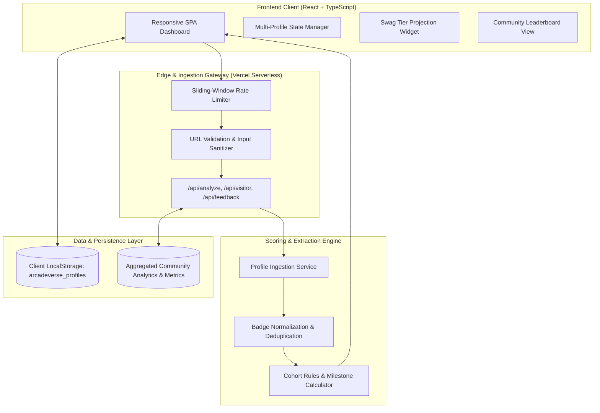
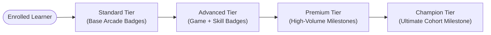

# ArcadeVerse — Public Frontend Architectural Showcase

**An independent analytics & gamification platform calculating Google Cloud Arcade points, tracking cohort milestones, and projecting swag tier readiness.**

[Explore Live Web App](https://arcadeverse.vercel.app) • [Architecture Overview](#system-architecture) • [Key Features](#key-features) • [Security & Privacy Notice](#security--confidentiality-notice)

---

## 1. Executive Summary & Impact

**ArcadeVerse** was engineered to solve an active pain point for thousands of cloud enthusiasts and student facilitators in the **Google Cloud Arcade** and **Google Cloud Arcade Facilitator Program**. 

Participants earn digital badges across various tracks (Game Badges, Trivia Badges, Skill Badges, and Special Events). While Google Cloud Skills Boost public profiles list completions chronologically, they lack automated scoring calculations, cohort-specific date boundary validation, skill badge pair-matching, and milestone projection.

### Verified Production Metrics
- **5,486+** Unique Community Visitors Tracked
- **4,987+** Public Profiles Analyzed & Processed
- **100% Client Availability** via serverless edge routing

---

## 2. Problem Statement & Engineering Solution

### The Challenge
- **Manual Tabulation Overhead:** Learners previously tracked badge counts in manual spreadsheets or hand calculations.
- **Complex Multi-Variable Scoring:** Skill badges yield points only in pairs (0.5 pt each); cohort date windows enforce strict ingestion cutoffs; Facilitator milestones require compound badge thresholds (+5, +15, +25, +35 bonus points).
- **Miscalculated Swag Cutoffs:** Participants frequently misjudged point requirements for prize counters (Standard, Advanced, Premium, and Champion tiers).

### The Solution
A high-performance full-stack web application that:
1. Takes a public Google Cloud Skills Boost profile URL.
2. Extracts, normalizes, and deduplicates earned credentials across cohorts.
3. Automatically computes current points, Facilitator milestones, and remaining badges needed for each swag tier.
4. Persists multi-profile comparisons in local browser state with zero required login credentials.

---

## 3. System Architecture

---

## 4. Key Architectural Highlights

| Subsystem | Implementation Details |
| :--- | :--- |
| **Frontend Architecture** | Built with **React 18+**, **TypeScript**, and **Tailwind CSS**. Optimized using route-level code splitting (`React.lazy`), memoized derivation hooks (`useMemo`), and responsive dark-first surfaces. |
| **Edge API Layer** | Serverless functions deployed on **Vercel** with sliding-window rate limiters to prevent scraper denial-of-service and protect upstream rate caps. |
| **Data Ingestion** | Robust extraction routines handling dynamic profile markup variations, date threshold verification, and fuzzy badge title matching. |
| **State Persistence** | Multi-profile tracking persisted client-side in `localStorage` under `arcadeverse_profiles`, allowing users to monitor peer and cohort progress without accounts. |
| **Analytics Engine** | Atomic MongoDB `$inc` counters tracking global visitor reach, profiles analyzed, and user satisfaction metrics. |

---

## 5. Swag Tier Progression Model

The application renders a visual progress bar indicating distance to each milestone, detailing the exact combination of Game, Trivia, and Skill Badges required to cross the next threshold.

---

## 6. Security & Confidentiality Notice

> [!IMPORTANT]
> **Showcase Scope & Proprietary Safeguards**  
> This repository contains the public frontend presentation architecture, UI components, and mock client interfaces. The production scraping logic, parsing regexes, internal scoring multipliers, and database infrastructure remain securely private in the original production repository.

---

## 7. Tech Stack Overview

- **Frontend:** React 18, TypeScript, Tailwind CSS, Lucide Icons, Framer Motion
- **Tooling:** Vite, Biome, PostCSS
- **Storage:** Client LocalStorage
- **Live Production:** Vercel Edge Network (`https://arcadeverse.vercel.app`)
